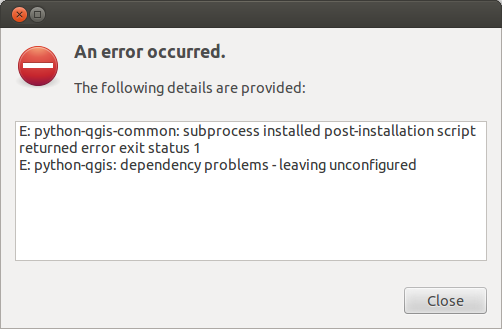

# Instalación {#sec-installation}

Python puede instalarse directamente desde la [página del proyecto](https://www.python.org/). Sin embargo, en este curso se utilizará otro procedimiento que facilita la gestión de diferentes versiones de Python y de sus paquetes.

Los **paquetes** amplían las funciones disponibles en Python. En el ámbito del análisis espacial, permiten realizar tareas como leer datos ráster, trabajar con geometrías o realizar análisis espaciales.

Esta gestión resulta especialmente útil porque programas como QGIS o ArcGIS Pro incluyen sus propios intérpretes de Python y bibliotecas geoespaciales.

Además, instalar los paquetes que permiten trabajar con información geográfica (como `rasterio` o `geopandas`) no es tan sencillo como podría parecer. Existen dependencias o módulos específicos (como `GDAL` o `PROJ`), que tienen que ser instalados junto a ellos, y un error en la instalación puede causar conflictos o errores en el futuro (ver @sec-conda, tercer párrafo).

## El problema de las versiones

Cada instalación de Python utiliza una versión concreta del intérprete, como Python 3.12 o Python 3.13. Además, un mismo ordenador puede contener varias instalaciones. Por ejemplo, QGIS o ArcGIS Pro pueden utilizar su propio Python, mientras que otros proyectos utilizan una instalación diferente.

La coexistencia de varias versiones no supone un problema, siempre y cuando cada proyecto utilice el intérprete y los paquetes adecuados. Las dificultades aparecen cuando varios proyectos comparten una misma instalación de Python y requieren versiones diferentes de sus paquetes o dependencias.

Por ejemplo, un usuario puede crear un programa que necesite una versión reciente de `rasterio` que incorpora una función necesaria para procesar determinados datos ráster. Al instalar esa versión en el Python utilizado por el sistema, también pueden cambiar algunas de sus dependencias, como NumPy o GDAL.

Si otro programa utilizaba ese mismo intérprete y dependía de versiones anteriores de esos paquetes, el cambio puede hacer que deje de funcionar. El nuevo programa funciona correctamente, pero una aplicación que antes funcionaba con esa instalación de Python puede empezar a producir errores.

El problema puede agravarse cuando se modifica el entorno de Python utilizado internamente por un SIG. Actualizar manualmente alguno de sus paquetes puede introducir versiones incompatibles con otras herramientas del programa (@fig-qgis-error).

{#fig-qgis-error}

Estos conflictos pueden evitarse mediante **entornos** de Python.

## Entornos o *Environments*

Un entorno **mantiene un conjunto independiente de paquetes y una versión específica de Python**. Así, cada proyecto puede disponer de las versiones que necesita sin modificar las del resto.

### El ecosistema Conda {#sec-conda}

Para crear estos entornos e instalar los paquetes necesarios existen diferentes herramientas. En este curso se utilizarán herramientas del **ecosistema Conda**.

[Conda](https://docs.conda.io/projects/conda/en/latest/index.html) es un sistema para **gestionar paquetes y entornos de trabajo**. Permite crear un entorno independiente para cada proyecto e instalar dentro de él una versión concreta de Python junto con los paquetes necesarios.

Además, Conda no se limita a instalar paquetes de Python. También instala los programas externos de los que dependen muchos paquetes. Esto resulta especialmente útil en ámbitos como el análisis espacial, donde se requieren herramientas (como `GDAL` o `PROJ`) que no forman parte directamente de Python.

Para instalar estos programas, las herramientas del ecosistema Conda descargan paquetes desde **repositorios**, también llamados **canales**. Uno de los canales más utilizados es **conda-forge**, que será el empleado en este curso. Es el canal que cuenta con las versiones más actualizadas de los paquetes espaciales.

Existen varias herramientas que integran el ecosistema Conda. En este curso se utilizará [Miniforge](https://conda-forge.org/), que contiene las funciones de Conda para la gestión de entornos mantenida por la comunidad de conda-forge.

### conda-forge y Miniforge {#sec-recipes}

El canal de [conda-forge](https://conda-forge.org/) es un proyecto comunitario. Mantiene un amplio repositorio de paquetes en formato **conda**, preparados para ser instalados mediante los gestores de paquetes.

El proyecto mantiene *recetas*: archivos que indican cómo preparar cada paquete y qué otros paquetes necesita. Estos últimos se denominan **dependencias**. Se verá con detalle un ejemplo en la @sec-install-env.

La herramienta Miniforge utiliza por defecto este canal. Es posible que algún alumno con conocimientos previos de Python haya oído hablar de Miniconda o Anaconda. Ambos son distribuciones que integran Conda, similares a Miniforge, pero están asociadas con el canal por defecto de la compañía Anaconda. Este canal está sujeto a sus términos y condiciones, y podrían requerirse licencias especiales para poder utilizarse. Miniforge y el canal `conda-forge` evitan este hecho.

::: {.callout-note}

Existe una alternativa a Miniforge, [utilizada en algunos cursos de Python y GIS](https://kodu.ut.ee/~kmoch/geopython2023/): [Micromamba](https://mamba.readthedocs.io/en/latest/user_guide/micromamba.html)

Micromamba es un sistema de gestión de entornos compatible con Conda, que no necesita ser instalado previamente. Por lo tanto, el proceso de instalación es mucho más rápido que Miniforge. Tan solo se requiere descargar el ejecutable, un único fichero, pequeño e independientemente del sistema operativo. Tampoco requiere de permisos de administrador.

Sin embargo, los comandos pueden variar ligeramente de los utilizados por Conda, y la integración con las IDE no es tan eficaz como Miniforge.

Los pasos para su instalación pueden consultarse en la [documentación oficial](https://mamba.readthedocs.io/en/latest/installation/micromamba-installation.html#manual-installation)

:::

## Instalación de Miniforge en Windows {#sec-install-miniforge}

En este curso se utilizará **Miniforge** para crear y gestionar los entornos de Python. Se explica aquí cómo instalarlo en Windows. Para otros sistemas operativos, consultar la [página de descarga de Miniforge](https://conda-forge.org/download/).

Durante la clase, y con el objetivo de familiarizarse con una consola de comandos, se realizará una instalación utilizando la consola de PowerShell. Sin embargo, también pude realizarse una instalación manual (ver @sec-manual-install).

### Instalación desde PowerShell

Se busca PowerShell en el menú de Windows y se abre una terminal. No es necesario ejecutarla como administrador.

Copia y ejecuta los siguientes comandos por separado, pulsando *Enter* después de cada uno.

#### 1. Descargar el instalador {.unnumbered}

Acceder al directorio personal del usuario (donde se guardará el ejecutable el archivo):

```powershell
Set-Location $env:USERPROFILE
```

Se descarga la última versión de Miniforge para Windows. La siguiente línea oculta la barra de progreso, que en algunas versiones de PowerShell ralentiza mucho la descarga.

```powershell
$ProgressPreference = 'SilentlyContinue'
```

El archivo ocupa alrededor de 90 MB, por lo que la descarga puede tardar unos minutos.

```powershell
Invoke-WebRequest -Uri https://github.com/conda-forge/miniforge/releases/latest/download/Miniforge3-Windows-x86_64.exe -OutFile Miniforge3.exe
```

#### 2. Ejecutar el instalador {.unnumbered}

Se ejecuta el instalador sin ventanas, indicando las mismas opciones que se elegirían en el asistente:

```powershell
Start-Process -Wait -FilePath .\Miniforge3.exe -ArgumentList "/InstallationType=JustMe /RegisterPython=0 /AddToPath=0 /S /D=$env:USERPROFILE\miniforge3"
```

La instalación no muestra ningún mensaje y puede tardar uno o dos minutos. Termina cuando vuelve a aparecer la línea de comandos.

#### 3. Configurar PowerShell para usar Conda {.unnumbered}

Tras la instalación, Conda solo está disponible desde una consola específica llamada **Miniforge Prompt**. Para poder utilizarlo desde cualquier terminal de PowerShell, incluida las de una IDE, es activar conda dentro de PowerShell con la siguiente línea:

```powershell
& "$env:USERPROFILE\miniforge3\Scripts\conda.exe" init powershell
```

Después, se desactiva el inicio automático con:

```powershell
& "$env:USERPROFILE\miniforge3\Scripts\conda.exe" config --set auto_activate false
```

La línea anterior previene la inicialización por defecto de Conda, que podría ocasionar problemas con otros programas (incluidos R y Arcgis Pro).

Al finalizar la instalación de Miniforge, en algunas versiones puede haber aparecido un mensaje que comienza por `WARNING` y sugiere utilizar `conda-pypi`. Es solo un consejo informativo, no un error, y puede ignorarse. Para evitar que este mensaje salga cada vez que se cree un nuevo entorno de trabajo con Python, ejecutar la siguiente línea:

```powershell
& "$env:USERPROFILE\miniforge3\Scripts\conda.exe" config --set plugins.conda_pypi_pip_warning false
```

Al finalizar, cerrar la consola.

### Instalación manual {#sec-manual-install}

#### 1. Descargar el instalador {.unnumbered}

Se accede a la [página de descarga de Miniforge](https://conda-forge.org/download/) y se descarga el instalador para **Windows x86_64**. Se obtendrá un archivo similar a `Miniforge3-Windows-x86_64.exe`.

#### 2. Ejecutar el instalador {.unnumbered}

Se hace doble clic sobre el archivo descargado y se siguen los pasos del asistente:

1. Pulsar *Next* y aceptar la licencia con *I Agree*.
2. En el tipo de instalación, seleccionar **Just Me**. De esta forma no se necesitan permisos de administrador.
3. Mantener la carpeta de instalación propuesta, similar a `C:\Users\nombre_usuario\miniforge3`.
4. En las opciones avanzadas, mantener las opciones marcadas por defecto. **No** es necesario marcar *Add Miniforge3 to my PATH environment variable*.
5. Pulsar *Install* y, al terminar, *Finish*.

::: {.callout-note}

Es recomendable que la ruta de instalación no contenga espacios ni caracteres especiales (tildes, ñ...). Si el nombre de usuario los contiene, puede indicarse otra carpeta, por ejemplo `C:\miniforge3`.

:::

#### 3. Configurar PowerShell para usar Conda {.unnumbered}

Se busca **Miniforge Prompt** en el menú de Windows, se abre y se ejecuta:

```{.powershell #lst-conda-init lst-cap="Inicialización de Conda en PowerShell"}
conda init powershell
```

Después, se ejecuta la siguiente línea. Previene la inicialización por defecto de Conda, que podría ocasionar problemas con otros programas (incluidos R y Arcgis Pro).

```powershell
conda config --set auto_activate false
```

Al finalizar la instalación de Miniforge, en algunas versiones puede haber aparecido un mensaje que comienza por `WARNING` y sugiere utilizar `conda-pypi`. Es solo un consejo informativo, no un error, y puede ignorarse. Para evitar que este mensaje salga cada vez que se cree un nuevo entorno de trabajo con Python, ejecutar la siguiente línea:

```powershell
conda config --set plugins.conda_pypi_pip_warning false
```

Al finalizar, cerrar la ventana.


::: {.callout-note}

Cuan se realiza la instalación desde PowerShell, en lugar de `conda` se escribe al inicio de la línea:

```powershell
& "$env:USERPROFILE\miniforge3\Scripts\conda.exe"
```

Se puede sustituir dentro de la consola de Miniforge por `conda` ya que la ruta al ejecutable (`conda.exe`) ha sido predefinida por defecto.

:::


### Comprobar la instalación

Se abre una terminal de **PowerShell** nueva y se ejecuta:

```powershell
conda --version
```

Si aparece un número de versión, por ejemplo `conda 25.x.x`, la instalación se ha realizado correctamente. Además, al inicio de la línea de comandos debería aparecer `(base)`, lo que indica que Conda está activo.

Para desactivar conda en PowerShell, si se deja de trabajar con el programa, es tan sencillo como:

```powershell
conda init --reverse powershell
```

::: {.callout-note}

Si al abrir PowerShell aparece un mensaje de error relacionado con una excepción de seguridad o con el archivo `profile.ps1`, puede ser necesario modificar la política de ejecución de PowerShell. Esta es una medida de seguridad de Windows que restringe la ejecución de determinados scripts.

Para permitir la ejecución de scripts locales, ejecutar en PowerShell:

```powershell
Set-ExecutionPolicy -ExecutionPolicy RemoteSigned -Scope CurrentUser
```

A continuación, cerrar PowerShell y abrir una terminal nueva.

Si el problema persiste en un ordenador del aula, se debe consultar al profesorado antes de modificar otras políticas.

:::

::: {.callout-warning}

El entorno `base` contiene la propia instalación de Conda. **No se deben instalar paquetes en él.** En la @sec-install-env se creará un entorno específico para el curso.

:::
