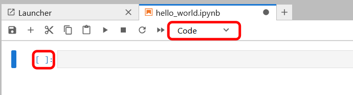

# Primeros pasos {#sec-first-steps}

Tras la instalación descrita en la @sec-installation, ya puede crearse un entorno virtual con Python y las herramientas necesarias para el curso. Los comandos siguientes se ejecutan en PowerShell.

## Crear un entorno de trabajo {#sec-install-env}

Se crea el entorno `hello_world` con el siguiente comando:

```powershell
conda create -n hello_world -c conda-forge python jupyterlab ipykernel git -y
```

Cada elemento cumple una función:

- `conda`: herramienta que ejecuta el comando.
- `create`: operación que crea el entorno.
- `-n hello_world`: nombre del entorno.
- `-c conda-forge`: canal del que se obtienen los paquetes.
- `python`: descarga del intérprete de Python.
- `jupyterlab`: paquete con la aplicación para trabajar con cuadernos Jupyter.
- `ipykernel`: componente que permite ejecutar Python desde los cuadernos.
- `git`: herramienta que permite el control de versiones y trabajar con repositorios
- `-y`: acepta la instalación sin solicitar confirmación.

Conda busca una combinación compatible de los paquetes y sus **dependencias**, es decir, los otros paquetes necesarios para que funcionen. Para ello, utiliza la información de los paquetes generados a partir de las recetas descritas en la @sec-recipes. Este proceso se denomina **resolución del entorno**: se seleccionan versiones que puedan funcionar juntas, aunque no sean las más recientes de cada paquete.

La terminal muestra los paquetes que se van a instalar y su ubicación. El proceso puede tardar varios minutos. Al terminar, aparece un mensaje similar a este:

```text
Transaction finished

To activate this environment, use:

    conda activate hello_world
```

### Activar y consultar el entorno

Se activa el entorno con:

```powershell
conda activate hello_world
```

El nombre aparece al principio de la línea de la terminal:

```text
(hello_world) PS C:\Users\nombre_usuario>
```

A partir de este momento, los comandos de Python y Jupyter utilizan los programas instalados en el entorno. La activación se aplica a la terminal actual; debe repetirse al abrir otra nueva.

Los entornos disponibles y sus ubicaciones se consultan con:

```powershell
conda env list
```

### Eliminar un entorno de trabajo {#sec-delete-env}

Esta operación elimina el entorno y sus paquetes. No es necesario realizarla para continuar con el curso.

Primero se desactiva el entorno, si está activo:

```powershell
conda deactivate
```

Después se elimina el entorno elegido. En este ejemplo, se eliminaría `hello_world`:

```powershell
conda remove -n hello_world --all
```

### Comandos adicionales

Para consultar otros comandos de `conda`, se puede ejecutar `conda --help`; para obtener ayuda sobre uno concreto, se añade `--help` al comando, por ejemplo, `conda create --help`.

Todos ellos pueden consultarse también en la [guía de comandos de Conda](https://docs.conda.io/projects/conda/en/latest/commands/index.html).

## Entorno integrado de desarrollo

En la introducción de esta asignatura se vio lo que era un IDE (*Integrated Development Environment*), un programa capaz de:

- Servir de **editor** avanzado (resalta la sintaxis y gestiona las sangrías)
- **Compilar** e **interpretar** código
- Integrar una consola o **terminal** que ejecute comandos
- [Opcional] **Depurador** integrado (facilitar la inspección del código)

Son necesarios a la hora de programar y escribir código, ya que agilizan la detección de errores y facilitan la escritura con múltiples atajos de teclado y funciones predefinidas. Reúnen todo lo necesario para poder programar en un solo lugar.

Python es un lenguaje ampliamente utilizado, por lo que la mayoría de los IDE lo integran. Las más utilizadas por los programadores son:

- [PyCharm](https://www.jetbrains.com/pycharm/): Aplicación con funcionalidades avanzadas integradas desde el inicio para trabajar con Python, herramientas basadas en inteligencia artificial y agentes. Es gratuita, pero cuenta con versión de pago que aumenta las funcionalidades.
- [Visual Studio Code](https://code.visualstudio.com/) (y su versión libre [VS Codium](https://vscodium.com/)): Ligera y compatible con múltiples lenguajes de programación. Es totalmente libre, aunque VS Code es desarrollada por Microsoft; VS Codium es una versión compilada a partir de su código abierto, sin telemetría. Es una de las más utilizadas.
- [Spyder](https://www.spyder-ide.org/): Similar a RStudio, pero orientada a Python. Está enfocada a la ciencia de datos.

### Jupyter y JupyterLab

[Jupyter](https://jupyter.org/about) es un proyecto de código abierto que desarrolla herramientas para trabajar de forma interactiva con distintos lenguajes de programación.

Los **cuadernos Jupyter** son archivos con extensión `.ipynb` que combinan celdas de código, texto explicativo, gráficos y otros resultados. Permiten ejecutar el código por partes y observar sus resultados junto a las instrucciones.

[JupyterLab](https://jupyterlab.readthedocs.io/en/stable/) es una aplicación que permite abrir y editar estos cuadernos desde un navegador. Incluye un explorador de archivos, pestañas, un editor de texto y terminales. El cuaderno es el documento; JupyterLab es una de las aplicaciones que permiten utilizarlo.

En las secciones introductorias de este curso, se usan los cuadernos de Jupyter y JupyterLab por ser intuitivos y permitir en un mismo lugar comentarios y código. Estas características los hacen muy eficientes para estructurar apuntes relacionados con Python.

::: {.callout-note}

JupyterLab es un entorno de trabajo orientado a la exploración de datos mediante cuadernos interactivos. Comparte herramientas con los entornos de desarrollo integrados (IDE), aunque estos suelen ofrecer más funciones para organizar, analizar y mantener proyectos de programación con numerosos archivos.

:::

## Configurar el directorio de trabajo {#sec-working-dir}

Los materiales del curso se encuentran en un **repositorio** de GitHub, un espacio en línea que almacena los archivos de un proyecto y el historial de sus cambios: <https://github.com/CristianICS/intro_python>.

La herramienta `git`, instalada en el entorno `hello_world` (@sec-install-env), permite descargar una copia del repositorio y actualizarla cuando se publiquen nuevos contenidos.

### Descargar los materiales

Se abre PowerShell y se activa el entorno:

```powershell
conda activate hello_world
```

A continuación, se accede a la carpeta en la que se guardarán los materiales, en este ejemplo la unidad `D:`. Si el ordenador no dispone de ella, puede utilizarse el directorio personal (`cd $env:USERPROFILE`).

```powershell
cd D:\
```

Por último, se descarga el repositorio:

```powershell
git clone https://github.com/CristianICS/intro_python.git
```

Esta operación se denomina **clonar** y solo debe realizarse una vez. Crea la carpeta `D:\intro_python`, que contiene todos los materiales del curso. Dentro de ella, la carpeta `notebooks` incluye los cuadernos de Jupyter con los que se desarrolla esta sección.

::: {.callout-important}

Para tomar apuntes o resolver los ejercicios, crear la carpeta `apuntes` dentro de `D:\intro_python` y trabajar sobre copias de los cuadernos guardadas en ella. Así, la actualización de los materiales no entra en conflicto con el trabajo propio.

:::

### Actualizar los materiales

El curso se amplía a lo largo del cuatrimestre. Para descargar los nuevos contenidos, se accede a la carpeta del curso y se ejecuta `git pull`:

```powershell
conda activate hello_world
cd D:\intro_python
git pull
```

Si no hay novedades, aparece el mensaje `Already up to date.`; en caso contrario, se muestra la lista de archivos añadidos o modificados.

#### Si la actualización falla {.unnumbered}

Si se ha modificado algún archivo descargado, `git pull` se detiene con un mensaje similar a:

```text
error: Your local changes to the following files would be overwritten by merge:
        notebooks/02_variables.ipynb
```

El comando `git status` muestra los archivos modificados. Para conservar los cambios, se copian esos archivos a la carpeta `apuntes`. Después, se recuperan las versiones originales y se repite la actualización:

```powershell
git restore .
git pull
```

`git restore .` descarta los cambios realizados en los archivos del repositorio. No afecta a los archivos nuevos, como los guardados en `apuntes`.

## Iniciar JupyterLab {#sec-init-jupyter}

Abrir PowerShell y activar el entorno creado en la @sec-install-env, que contiene los paquetes necesarios para ejecutar JupyterLab:

```powershell
conda activate hello_world
```

Se inicia JupyterLab indicando la carpeta con el directorio de trabajo:

```powershell
jupyter lab --notebook-dir="D:/intro_python"
```

La ruta debe sustituirse por la de la carpeta creada. Las comillas permiten utilizar rutas que contengan espacios.

El comando inicia un **servidor local**, un programa que permite acceder a JupyterLab desde el navegador del propio ordenador. Normalmente se abre una pestaña de forma automática. Si no se abre, puede copiarse en el navegador la dirección que muestra la terminal.

{#fig-jupyterlab}

El explorador de archivos de la izquierda muestra el contenido de la carpeta elegida (@fig-jupyterlab). La terminal de PowerShell permanece ocupada mientras el servidor está en funcionamiento.

Para terminar la sesión, se pulsa `Ctrl + C` en la terminal y se confirma el cierre. Cerrar únicamente la pestaña del navegador no detiene el servidor.

## Crear el primer cuaderno

Con JupyterLab en funcionamiento, se crea un cuaderno desde el menú:

```text
File -> New -> Notebook
```

A continuación, se selecciona `Python 3 (ipykernel)`. El **núcleo** o *kernel* es el proceso que ejecuta el código del cuaderno y conserva los datos mientras permanece activo.

El archivo se abre en una pestaña con un nombre similar a `Untitled.ipynb`. Puede cambiarse pulsando con el botón derecho sobre su nombre en el explorador de archivos. Se selecciona *Rename* y se escribe `hello_world.ipynb`. También puede seleccionarse desde el menú superior, dentro de la pestaña *File*.

La primera celda del cuaderno se crea automáticamente. Es una celda que permite introducir código, indicado por los corchetes (`[ ]`) en el lado izquierdo de la celda y el texto *Code* en la línea superior (@fig-blank).

{#fig-blank}

Si se selecciona el desplegable donde se lee *Code*, se puede cambiar a la opción *Markdown*. Al hacerlo, se debe comprobar que los dos corchetes han desaparecido. Se escribe en la celda el siguiente texto:

```text
Primer cuaderno de Jupyter en JupyterLab
```

Después, se pulsa `Ctrl + Enter` para ejecutar la celda. Al ser texto, la celda se muestra con formato. Para volver a editarla, se hace doble clic sobre ella.

El texto dentro de este tipo de celdas puede formatearse utilizando el [estilo Markdown](https://www.markdownguide.org/basic-syntax/). Por ejemplo, para convertir la línea anterior en un encabezado de primer nivel, se añade `#` al inicio de la línea y se vuelve a ejecutar la celda.

Se sitúa el cursor debajo de la celda anterior hasta que aparezca el mensaje *Click to add a cell*. Al pulsar sobre el recuadro, se genera una nueva línea de código. Todo el texto que se incluya en ellas deberá estar escrito en formato de Python.

En la nueva línea de código se escribe lo siguiente:

```python
print("Hola, mundo")
```

Al contrario que en la celda de texto, las palabras se han coloreado de un modo distinto en función de diferentes características en base al lenguaje de Python.

Al pulsar `Shift + Enter`, se ejecuta la celda y aparece el texto `Hola, mundo` debajo, es decir, el resultado del código ejecutado. Se habrá creado una nueva celda de código, ya que el atajo de teclado `Shift + Enter` ejecuta la celda y pasa a la siguiente. Además, en los corchetes a la izquierda de la celda aparecerá `[1]`. Este número indica el orden de ejecución dentro de la sesión del núcleo, no cuántas veces se ha ejecutado esa celda. Al ejecutar otra celda, o repetir la misma, el contador aumenta.

Por último, se guarda el cuaderno con `Ctrl + S`.

Se irán viendo diferentes funciones de la aplicación durante el curso. La [guía de cuadernos de JupyterLab](https://jupyterlab.readthedocs.io/en/stable/user/notebook.html) describe otras opciones de edición y ejecución.

## Introducción a los cuadernos en JupyterLab

Si se ha activado JupyterLab siguiendo los pasos de la @sec-init-jupyter, en el panel de la izquierda podrá encontrarse el navegador. Si no se ve, ir al menú *View* en la pestaña superior y seleccionar *File Browser*. También puede teclearse el comando `Ctrl + Shift + F`. Dentro del navegador, buscar dentro de la carpeta `notebooks/examples` el cuaderno `00_intro_jupyterlab.ipynb`.

En él se detallan toda una serie de propiedades de la aplicación útiles durante el desarrollo del curso.
