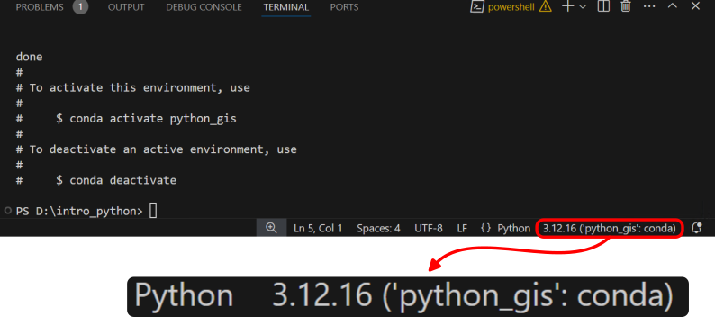

# Crear programas {#sec-scripting}

En Python, el flujo de trabajo habitual es crear archivos `.py` con las operaciones que se quieren realizar. Estos archivos se ejecutan de arriba abajo, y finalizan al acabar. Se evitan así los problemas que podrían ocasionarse dentro de un cuaderno de Jupyter si las celdas no se ejecutan en orden.

Por ejemplo, si en una celda se trabaja con una variable pero esta se define en una celda anterior, el código fallará si no se ejecuta esta última. En un programa `.py` esto es más difícil que suceda.

Escribir programas o *scripts* de Python es una tarea que puede ser complicada al principio por la cantidad de errores que pueden cometerse:

1. Escribir mal una variable
2. Utilizar funciones no definidas
3. Llamar a un módulo que no existe
4. ...

Al trabajar con JupyterLab se han comprobado algunas de sus ventajas al escribir código con Python, como por ejemplo el empleo del color para diferenciar los elementos de la sintaxis o el autocompletado de los paréntesis y corchetes. Sin embargo, existen programas mucho más avanzados que cuentan con más funcionalidades. En la sección "Entorno integrado de desarrollo" del @sec-first-steps se introdujeron los programas de este tipo (IDE) más utilizados en Python. Durante este curso se utilizará [VSCodium](https://vscodium.com/).

## Instalar un nuevo entorno

Antes de comenzar, se va a instalar un nuevo entorno con los paquetes necesarios para esta parte del curso. Se utiliza ahora un archivo YAML (`.yml`) que contiene el nombre de los paquetes. Esto hace que no sea necesario escribirlos en la terminal, como se hacía en @sec-install-env.


::: {.callout-important}

Se debe comprobar que no existe ningún entorno activado antes de comenzar la instalación. Es decir, que la línea de la terminal no empieza con `(hello_world)`. Debe comenzar con `PS` (PowerShell).

:::

1. Se abre VSCodium.
2. Se abre la carpeta del curso de Python con `Ctrl + K` seguido de `Ctrl + O`. También puede abrirse desde el menú superior *File* > *Open Folder*.
3. Aparece un mensaje preguntando si se confía en los autores de la carpeta. Se pulsa el botón *I trust* aceptando el riesgo.
4. Se abre una nueva terminal con `Ctrl + ñ` o, en el menú superior, *Terminal* > *New Terminal*.
5. Se abrirá una nueva terminal en PowerShell. Gracias a la configuración realizada en @sec-install-miniforge, se puede ejecutar `conda` dentro de la terminal.
6. Se comprueba que la ruta que aparece en la primera línea de la terminal es la de la carpeta abierta en el paso 2. De lo contrario, se cambia la ruta de la terminal por la del curso, por ejemplo `cd D:\intro_python`.
7. Se ejecuta la siguiente línea:

    ```powershell
    conda env create -f environment.yml -y
    ```

La línea ahora es distinta de la utilizada en la @sec-install-env. No hace falta especificar el nombre del entorno ni de los paquetes porque todos ellos están incluidos en el archivo `.yml`. Para consultarlo, se abre el explorador de archivos de VSCodium desde el menú lateral izquierdo, pulsando sobre el icono con dos hojas o utilizando el atajo `Ctrl + Shift + E`, y se pulsa sobre `environment.yml`:

```yml
# Nombre del nuevo entorno
name: python_gis
# Canal del que se instalan los paquetes. Es el recomendado para instalar
# librerías espaciales (gdal, rasterio, geopandas etc.)
channels:
  - conda-forge
# Paquetes a instalar
dependencies:
  - python=3.12

# Trabajo con matrices, archivos tabulares (csv) y análisis de datos
  - numpy
  - scipy
  - pandas
  - scikit-learn

# Manejo de datos vectoriales
  - geopandas
  - shapely
  - pyproj
  - pyogrio
  - fiona
  - mapclassify

# Manejo de datos raster
  - gdal
  - rasterio
  - xarray
  - rioxarray

# Corrección atmosférica 6S y Google Earth Engine API
  - py6s
  - earthengine-api

# Herramientas para crear gráficos y representaciones
  - matplotlib
  - seaborn
  - contextily
  - folium

# JupyterLab
  - jupyterlab
  - ipykernel

# Formateado de Python siguiendo las recomendaciones de la PEP 8
  - flake8
  - autopep8
```

::: {.callout-tip}

# ¿Por qué Python 3.12?

Se ha elegido Python 3.12 porque ofrece el mejor equilibrio entre estabilidad y compatibilidad cuando se trabaja con datos geográficos. Las bibliotecas geoespaciales (GDAL, rasterio, geopandas, pyproj) dependen de componentes compilados y tardan en publicar versiones para las ediciones más recientes de Python, mientras que la 3.12 ya cuenta con soporte completo en conda-forge y sus principales errores de compatibilidad están resueltos. Además, sigue recibiendo actualizaciones de seguridad durante años, de modo que el entorno no quedará obsoleto.

:::

## Configurar VSCodium

### Instalar las extensiones necesarias

VSCodium cuenta con extensiones o paquetes que permiten ampliar sus funcionalidades cuando se trabaja con un lenguaje. Existen extensiones para todo tipo de lenguajes, como R o Python.

En el panel de extensiones (`Ctrl + Shift + X`), se buscan e instalan:

| Extensión | Identificador | Para qué sirve |
|-----------|---------------|----------------|
| **Python** | `ms-python.python` | Soporte básico de Python, ejecución y depuración |
| **Flake8** | `ms-python.flake8` | *Linter*: avisa de errores y de incumplimientos de PEP 8 |
| **autopep8** | `ms-python.autopep8` | Formateado automático según PEP 8 |

> **Si alguna extensión no aparece** en el buscador (Codium no siempre tiene todas las extensiones de Microsoft), puede utilizarse esta alternativa, que sustituye a Flake8 y autopep8 a la vez: **Ruff** (`charliermarsh.ruff`).

### Configurar el límite de 79 caracteres y otras reglas de estilo

VSCodium cuenta con un archivo de configuración donde se almacenan las opciones del programa.

1. Se pulsa `Ctrl + Shift + P` para abrir el menú de opciones.
2. Se escribe **Preferences: Open User Settings (JSON)** y se pulsa `Enter`.
3. Se añade el siguiente contenido dentro de las llaves `{ }` (si el archivo ya tiene ajustes, se separan con comas sin duplicar claves):

```json
{
    // --- Editor general ---
    "editor.rulers": [79],
    "editor.wordWrap": "off",
    "editor.tabSize": 4,
    "editor.insertSpaces": true,
    "editor.detectIndentation": false,
    "editor.renderWhitespace": "trailing",

    // --- Archivos ---
    "files.encoding": "utf8",
    "files.eol": "\n",
    "files.trimTrailingWhitespace": true,
    "files.insertFinalNewline": true,
    "files.trimFinalNewlines": true,
    "files.autoSave": "afterDelay",

    // --- Específico para Python ---
    "[python]": {
        "editor.rulers": [79],
        "editor.tabSize": 4,
        "editor.defaultFormatter": "ms-python.autopep8",
        "editor.formatOnSave": true
    },

    // --- Linter y formateador: máximo 79 caracteres ---
    "flake8.args": [
        "--max-line-length=79"
    ],
    "autopep8.args": [
        "--max-line-length=79"
    ],

    // --- Terminal ---
    "python.terminal.activateEnvironment": true
}
```

| Ajuste | Valor | Efecto |
|--------|-------|--------|
| `editor.rulers` | `[79]` | Dibuja una línea vertical en la columna 79 como guía visual. No impide escribir más allá; solo avisa visualmente. Admite varias columnas, por ejemplo `[72, 79]`. |
| `editor.wordWrap` | `"off"` | Desactiva el ajuste de línea visual. Las líneas largas no se parten en pantalla, así que se ve claramente cuándo se pasa de 79 caracteres. Se puede activar/desactivar con el comando `Alt + Z` |
| `editor.tabSize` | `4` | Una tabulación equivale visualmente a 4 espacios, como pide PEP 8. |
| `editor.insertSpaces` | `true` | Al pulsar la tecla Tab se insertan espacios en lugar del carácter de tabulación. Evita mezclar ambos, que en Python provoca `IndentationError`. |
| `editor.detectIndentation` | `false` | Impide que el editor adivine la sangría según el contenido del archivo. Así siempre se aplican `tabSize` e `insertSpaces`, aunque el archivo abierto use otra convención. |
| `editor.renderWhitespace` | `"trailing"` | Muestra con puntos solo los espacios sobrantes al final de las líneas, que Flake8 señala como error (`W291`, `W293`). |
| `files.encoding` | `"utf8"` | Guarda los archivos en UTF-8, necesario para tildes, eñes y otros caracteres especiales sin corrupción. |
| `files.eol` | `"\n"` | Fuerza saltos de línea de estilo Unix (LF) en todos los sistemas. Evita diferencias entre Windows (CRLF) y macOS/Linux al compartir código. |
| `files.trimTrailingWhitespace` | `true` | Al guardar, elimina los espacios y tabulaciones al final de cada línea. |
| `files.insertFinalNewline` | `true` | Al guardar, añade un salto de línea al final del archivo si falta. PEP 8 y Flake8 lo exigen (`W292`). |
| `files.trimFinalNewlines` | `true` | Al guardar, elimina las líneas en blanco sobrantes al final del archivo, dejando solo una (`W391`). |
| `files.autoSave` | `"afterDelay"` | Guarda automáticamente el archivo tras una breve pausa (por defecto 1 segundo), evitando perder trabajo. Ver la nota al final. |
| `[python]` | `{ ... }` | Agrupa ajustes que se aplican **solo** a archivos `.py`. Los ajustes de dentro tienen prioridad sobre los generales. |
| `editor.rulers` (dentro de `[python]`) | `[79]` | Repite la regla de la columna 79 específicamente para Python, por si el ajuste general se cambia más adelante. |
| `editor.tabSize` (dentro de `[python]`) | `4` | Repite los 4 espacios de indentación específicamente para Python. |
| `editor.defaultFormatter` | `"ms-python.autopep8"` | Indica qué extensión da formato al código Python. Sin esto, el editor puede preguntar cuál usar o no formatear. |
| `editor.formatOnSave` | `true` | Aplica el formateador automáticamente al guardar con `Ctrl + S`. |
| `flake8.args` | `["--max-line-length=79"]` | Argumentos que recibe Flake8. Aquí fija el máximo en 79 caracteres; si una línea lo supera, se subraya y aparece el aviso `E501`. |
| `autopep8.args` | `["--max-line-length=79"]` | Argumentos que recibe autopep8. Hace que al formatear intente partir las líneas largas respetando el límite de 79. |
| `python.terminal.activateEnvironment` | `true` | Al abrir una terminal nueva, activa automáticamente el entorno seleccionado (`python_gis`). Así no hay que ejecutar el comando de activación a mano. |

> **Nota sobre el guardado automático:** con `files.autoSave` en `"afterDelay"`, el formateo al guardar (`formatOnSave`) **no se ejecuta** en los guardados automáticos, solo cuando se pulsa `Ctrl + S`. Para que se formatee siempre, se cambia el valor a `"onFocusChange"` (guarda al cambiar de archivo o de ventana) o se elimina la línea de `autoSave`.

> **Nota sobre `files.eol`:** el valor `"\n"` puede dar avisos en Windows con algunas herramientas antiguas.

## Seleccionar el intérprete de Python

Antes de ejecutar cualquier código, hay que indicar a VSCodium qué intérprete de Python debe usar, porque de ello depende qué bibliotecas están disponibles y con qué versión de Python se ejecutan los programas.

El intérprete se selecciona desde el menú de comandos. Se pulsa `Ctrl + Shift + P` y se escribe **Python: Select Interpreter**. Se elige, de la lista con los entornos disponibles, el que se ha creado al principio de este capítulo: `python_gis`.

Se comprueba que la selección es correcta en la barra de estado, en la esquina inferior derecha, donde debe aparecer el nombre y la versión del entorno elegido (@fig-interpreter).

{#fig-interpreter}

Si el entorno no aparece en la lista, se abre una terminal nueva o se busca y ejecuta **Developer: Reload Window** dentro del panel de comandos (`Ctrl + Shift + P`) y se vuelve a intentar. Si sigue sin aparecer, se selecciona **Enter interpreter path...** desde el panel **Python: Select Interpreter** y se localiza manualmente el ejecutable de Python del entorno. Para conocer su localización, incluir en la consola la línea `conda env list`. A la derecha del nombre del entorno aparecerá su localización.

## Comprobar que todo funciona

Se crea un primer programa:

1. En el explorador (`Ctrl + Shift + E`), se crea un archivo nuevo llamado `hola.py`.
2. Se escribe este código (la segunda línea es **intencionadamente demasiado larga**):

   ```python
   print("Hola, mundo")
   mensaje = "Esta es una línea deliberadamente muy larga para comprobar que el linter nos avisa del límite"
   print(mensaje)
   x=1+2
   ```

Se debería ver lo siguiente:

- Una **línea vertical** en la columna 79.
- La segunda línea **subrayada** en amarillo o rojo. Al pasar el ratón por encima aparece el aviso `E501 line too long (xx > 79 characters)`.
- En el panel *Problems* (`Ctrl + Shift + M`) aparece el mismo aviso.

Al guardar el archivo con `Ctrl + S`, la línea `x=1+2` se convierte en `x = 1+2`. Se cambia al formato exigido por la PEP 8.


### Ejecutar el programa

- Se pulsa el botón *▶ (Run Python File)* de la esquina superior derecha, o
- en la terminal integrada (`Ctrl + ñ`) se escribe `python hola.py`.

Las dos opciones realizan la misma operación: ejecutan el código dentro de `hola.py` utilizando el intérprete de Python que contiene el entorno `python_gis`.

## Problemas y errores

Durante la ejecución del código, pueden ocurrir algunos errores relacionados con la llamada al intérprete de Python. Aunque se haya seleccionado el entorno `python_gis` como intérprete, al pulsar sobre el botón *▶ (Run Python File)* el programa puede fallar al importar bibliotecas espaciales como `geopandas`, `rasterio` o `pyproj`.

### Síntoma 

Al ejecutar el programa, la terminal muestra mensajes de error que indican que no se localizan las bibliotecas GDAL o PROJ. Algunos ejemplos habituales son:

```text
ImportError: DLL load failed while importing _gdal
```

```text
PROJ: proj_create_from_database: Cannot find proj.db
```

### Causa

GDAL y PROJ no son bibliotecas escritas en Python, sino componentes compilados que el entorno instala en sus propias carpetas. Para que Python pueda encontrarlos, el entorno debe estar **activado**. La activación (`conda activate`) no se limita a elegir el intérprete: también indica al sistema en qué carpetas se encuentran estos componentes y sus archivos de datos (por ejemplo, `proj.db`).

El botón *▶ (Run Python File)* llama directamente al ejecutable de Python del entorno. Si por algún motivo la activación no se completa antes de la ejecución, el intérprete correcto se ejecuta, pero sin la información necesaria para localizar GDAL y PROJ. El resultado son los errores anteriores, aunque el entorno y las bibliotecas estén correctamente instalados.

### Solución

Se activa el entorno manualmente en la terminal y se ejecuta el programa desde ella:

1. Se abre una terminal nueva con `Ctrl + ñ`.
2. Se activa el entorno:

    ```powershell
    conda activate python_gis
    ```

3. Se comprueba que la línea de la terminal comienza con `(python_gis)`.
4. Se comprueba que la ruta de la terminal es la de la carpeta que contiene el programa. De lo contrario, se cambia con `cd`, por ejemplo `cd D:\intro_python`.
5. Se ejecuta el programa escribiendo `python` seguido del nombre del archivo:

    ```powershell
    python hola.py
    ```

::: {.callout-tip}

Mientras la terminal permanezca abierta, el entorno sigue activado. Basta con repetir el paso 5 cada vez que se quiera ejecutar de nuevo el programa. Si se cierra la terminal, deben repetirse todos los pasos.

:::

## Atajos de teclado útiles

| Acción | Atajo |
|--------|-------|
| Paleta de comandos | `Ctrl + Shift + P` |
| Abrir terminal integrada | `Ctrl + ñ` |
| Panel de extensiones | `Ctrl + Shift + X` |
| Panel de problemas | `Ctrl + Shift + M` |
| Guardar | `Ctrl + S` |
| Dar formato al documento | `Shift + Alt + F` |
| Comentar/descomentar línea | `Ctrl + Ç` (o `Ctrl + .` / `Ctrl + 7` en teclados con otros idiomas) |
| Buscar en el archivo | `Ctrl + F` |

> Algunos atajos pueden variar según la distribución del teclado. Si alguno no funciona, puede buscarse en *File* > *Preferences* > *Keyboard Shortcuts*.

### Cambiar el idioma (opcional)

1. Se abre el panel de extensiones: `Ctrl + Shift + X`.
2. Se busca **Spanish Language Pack for Visual Studio Code**.
3. Se pulsa *Install* y se reinicia VSCodium cuando lo solicite.
