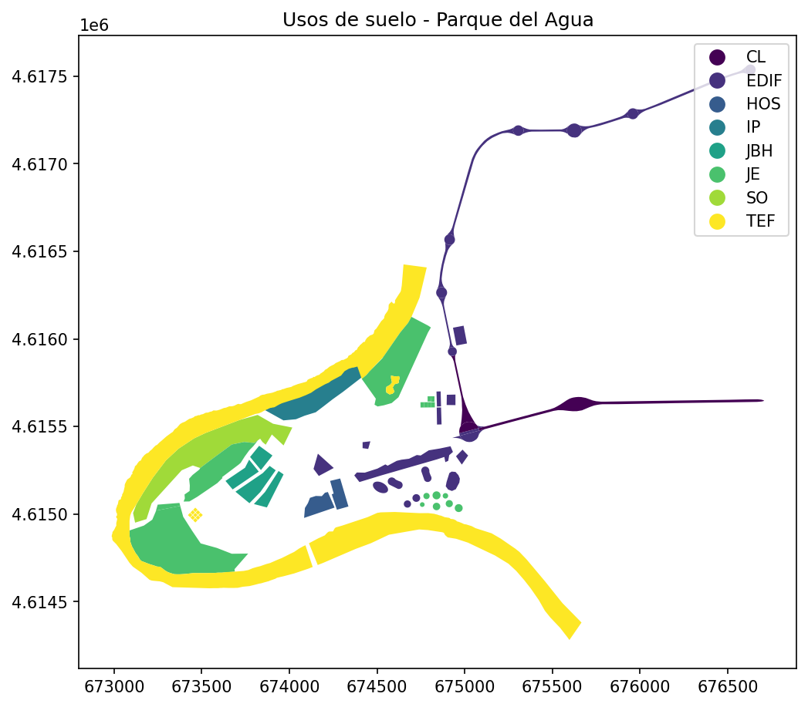

# Datos vectoriales {#sec-vectors}

Los **datos vectoriales** representan entidades geográficas mediante geometrías (puntos, líneas o polígonos) asociadas a una tabla de atributos. Este capítulo aplica el flujo de trabajo con programas `.py` descrito en el @sec-scripting a este tipo de datos.

Python no incluye un tipo de datos capaz de trabajar con este tipo de información, pero existe una librería que permite leerla y guardarla en su propia estructura de tabla, el `GeoDataFrame`: [GeoPandas](https://geopandas.org/en/stable/).

Es una extensión de la librería [Pandas](https://pandas.pydata.org/), que permite trabajar con tablas de forma eficiente. Es una de las opciones que tiene Python de trabajar con datos tabulares (de manera similar a los objetos `data.frame` integrados en R). GeoPandas permite además realizar operaciones espaciales con los datos vectoriales, que son una unión de tablas y coordenadas.

No se verá el módulo de Pandas, pero todas las funciones utilizadas para trabajar con las tablas de atributos en GeoPandas pueden aplicarse con Pandas.

Durante esta primera sección se va a trabajar con una versión reducida de la base de datos `gdb` utilizada en la asignatura de SIG. Se encuentra comprimida en la carpeta `data` del repositorio del curso: [`parque_agua_v2.gdb.zip`](https://github.com/CristianICS/intro_python/blob/main/data/parque_agua_v2.gdb.zip).

::: {.callout-warning}

# Base de datos de ejemplo y bases de datos propias

Los ejemplos de este capítulo utilizan la base de datos `parque_agua_v2.gdb` proporcionada en el curso. Si se trabaja con la base de datos propia creada en la asignatura de SIG, es posible que no contenga algunas de las capas utilizadas (por ejemplo, `UsosSuelo`) o que sus columnas tengan otros nombres (por ejemplo, `Uso`). En ese caso, el código devolverá errores, y los resultados (número de entidades, códigos de uso o áreas) no coincidirán con los mostrados.

Esto no es ningún problema. Simplemente deberán adaptarse en el código los nombres de las capas y de las columnas.

:::

Antes de comenzar, se crea un nuevo archivo dentro de la carpeta `./python` con el nombre `geopandas_intro.py`. En él se pegarán los trozos de código que se irán explicando en esta sección.

## Leer datos {#sec-read-vectors}

La librería GeoPandas permite leer los archivos soportados por el programa de código abierto [GDAL/OGR](https://gdal.org/en/stable/drivers/vector/index.html). Entre ellos, [las bases de datos de ESRI](https://gdal.org/en/stable/drivers/vector/filegdb.html) (FileGDB).

Antes de leer la base de datos, se descomprime el archivo `data/parque_agua_v2.gdb.zip`. En el explorador de archivos de Windows, se hace clic derecho sobre él, se selecciona *Extraer todo...* y se indica como destino la carpeta `data`. Windows propone por defecto la ruta `data\parque_agua_v2.gdb`, por lo que se borra la última parte para no crear una carpeta dentro de otra con el mismo nombre. El resultado debe ser la carpeta `data\parque_agua_v2.gdb`.

Una base de datos de ESRI no es un único archivo, sino una **carpeta** que contiene varios archivos internos (con extensiones como `.gdbtable`). Por ese motivo, la ruta utilizada en el código apunta a la carpeta `parque_agua_v2.gdb`, sin entrar en ella.

Los datos vectoriales se pueden leer con GeoPandas utilizando la función [`read_file()`](https://geopandas.org/en/stable/docs/reference/api/geopandas.read_file.html#geopandas.read_file).

```python
import geopandas as gpd

parque_agua_fp = r"D:\...\intro_python\data\parque_agua_v2.gdb"

parque_agua = gpd.read_file(parque_agua_fp)

print(type(parque_agua))
```

El código realiza las siguientes operaciones:

- `import geopandas as gpd` carga la librería GeoPandas con el nombre abreviado `gpd`.
- La variable `parque_agua_fp` guarda la ruta a la base de datos (`fp`, de *file path*, "ruta del archivo"). Debe sustituirse `D:\...` por la ubicación de la carpeta del curso en el ordenador.
- `gpd.read_file()` lee la base de datos y guarda su contenido en la variable `parque_agua`.
- `print(type(parque_agua))` muestra el tipo de objeto que ha devuelto la función.

La ruta se escribe con una `r` delante de las comillas. En Windows, las carpetas se separan con barras invertidas (`\`), un carácter que Python utiliza dentro de los textos para escribir caracteres especiales (por ejemplo, `\n` representa un salto de línea). La `r` (de *raw*, "sin procesar") indica a Python que lea el texto tal cual, sin interpretar las barras invertidas.

La salida del código anterior dará como resultado el siguiente texto:

```text
C:\...\geopandas.py:382: UserWarning: More than one layer found in 'parque_agua_v2.gdb':
'PGOU' (default), 'Vias',... Specify layer parameter to avoid this warning.

<class 'geopandas.geodataframe.GeoDataFrame'>
```

La primera parte se corresponde con un **mensaje de advertencia** (*warning*) de la función `read_file()`. Una advertencia no es un error: el programa no se detiene, pero Python avisa de algo que puede producir resultados inesperados. En este caso, la función se ha ejecutado, pero ha detectado varias tablas dentro de la base de datos. Por defecto se carga la primera (`PGOU` en el ejemplo anterior).

La segunda parte es el resultado de la función `print()`, que devuelve el tipo de objeto en el que se ha convertido la tabla: `GeoDataFrame`. Este objeto se define dentro de la librería GeoPandas y no se encuentra dentro de los tipos de objeto por defecto de Python.

::: {.callout-note}

El objeto `GeoDataFrame` extiende las funcionalidades de [`pandas.DataFrame`](https://pandas.pydata.org/docs/reference/api/pandas.DataFrame.html). Ambos pueden modificarse con los mismos métodos, con el añadido de los métodos espaciales que contiene GeoDataFrame (por ejemplo, uniones espaciales).

:::

Se sobrescriben las dos últimas líneas del código anterior por las siguientes:

```python
parque_agua_lyrs = gpd.list_layers(parque_agua_fp)
print(parque_agua_lyrs)
```

El código resultante deberá devolver el siguiente mensaje:

```text
                  name    geometry_type
0                 PGOU     MultiPolygon
1                 Vias  MultiLineString
2        Portales_ED50            Point
3            UsosSuelo   MultiPolygon Z
4       T_1_DirtyAreas     MultiPolygon
5      T_1_PointErrors            Point
6       T_1_LineErrors  MultiLineString
7       T_1_PolyErrors     MultiPolygon
8   Vias_selectionAnno     MultiPolygon
9           Ornamental          Point Z
10  Ornamental__ATTACH             None
11     Ornamental_agol          Point Z
12      InfoOrnamental             None
13        InfoArtistas             None
```

La función `list_layers()` genera una tabla con el nombre de las capas disponibles dentro de una base de datos y su tipo de geometría. Facilita la inspección de su contenido y la selección de una de las capas.

Se cambia la última línea del código, la función `print()`, por las siguientes líneas:

```python
usos_suelo = gpd.read_file(parque_agua_fp, layer="UsosSuelo")
print(usos_suelo.head())
```

La primera línea lee la capa `UsosSuelo` y la guarda como un objeto `GeoDataFrame` en la variable `usos_suelo`. Después, el método `head()` muestra las cinco primeras filas de la tabla (el equivalente a `head()` en R).

```text
   Shape_Length  ...                                           geometry
0    111.825836  ...  MULTIPOLYGON Z (((674793.033 4615088.973 0, 67...
1    143.455653  ...  MULTIPOLYGON Z (((674853.986 4615089.351 0, 67...
2    127.765279  ...  MULTIPOLYGON Z (((674895.095 4615048.008 0, 67...
3    133.737132  ...  MULTIPOLYGON Z (((674826.093 4615026.409 0, 67...
4     83.797663  ...  MULTIPOLYGON Z (((674768.804 4615046.571 0, 67...
```

Si la base de datos utilizada no contiene esta capa, se recomienda seleccionar otra con geometrías de tipo polígono (por ejemplo, `MultiPolygon` o `MultiPolygon Z`) y con algún campo significativo, ya que en las siguientes secciones se creará un mapa y se calculará el área de sus entidades. No debe elegirse ninguna capa con valor `None` en la columna `geometry_type`, ya que corresponden a tablas sin geometría.

La tabla tiene demasiadas columnas para caber en la consola, por lo que se abrevia con puntos suspensivos (`...`).

Los números de la izquierda (0, 1, 2...) forman el **índice** de la tabla, es decir, las etiquetas que identifican cada fila (el equivalente a los nombres de fila en R). Por defecto, son números consecutivos que empiezan en 0.

## Crear mapas {#sec-vector-maps}

Existe un método que permite mostrar los resultados en un mapa. Se añaden las siguientes dos líneas al final del programa y se ejecuta de nuevo el código:

```python
usos_map = usos_suelo.plot()
usos_map.figure.savefig("usos_suelo_map.png")
```

[Matplotlib](https://matplotlib.org/) es una de las librerías de Python más utilizadas para representar gráficos (el equivalente en R sería `ggplot2`). Este curso no entra en los detalles de esta librería, pero van a verse algunas de sus funciones al trabajar con sus objetos. Las dos líneas anteriores realizan las siguientes operaciones:

- `plot()` dibuja las geometrías de la capa y devuelve un objeto `Axes` (`<class 'matplotlib.axes._axes.Axes'>`), el área de dibujo donde se representa el mapa.
- El área de dibujo forma parte de una **figura** (un objeto `matplotlib.figure.Figure`), el lienzo completo que se guarda como imagen. El **atributo** `figure` del objeto `Axes` permite acceder a ella.
- El método `savefig()` de la figura guarda el mapa en un archivo de imagen con el nombre indicado.

::: {.callout-note}

Un **atributo** es un valor asociado al objeto que se consulta sin paréntesis (ver [08_import_open.ipynb](https://github.com/CristianICS/intro_python/blob/main/notebooks/08_import_open.ipynb)), mientras que un método se llama con paréntesis. VS Code resalta los atributos y los métodos con colores distintos, lo que ayuda a diferenciarlos. Por ejemplo, en `usos_map.figure.savefig()`, `figure` y `savefig` aparecen en colores diferentes. Los colores concretos dependen del tema del editor.

:::

El mapa se guarda en el **directorio de trabajo**, la carpeta desde la que se ejecuta el programa en PowerShell. Si la nueva línea de la terminal muestra `(python_gis) PS D:\intro_python>`, el mapa se guarda dentro de la carpeta del curso.

Se eliminan las tres últimas líneas del código y se escribe la siguiente:

```python
print(usos_suelo.columns)
```

Los objetos `geopandas.GeoDataFrame` y `pandas.DataFrame` incluyen el atributo `columns`, que devuelve las columnas incluidas en la tabla. En el ejemplo, las siguientes:

```text
Index(['Shape_Length', 'Shape_Area', 'id_US', 'Naturaleza', 'Clase', 'Uso',
       'Descripcion', 'Fecha', 'id_PGOU', 'count_portal', 'Tasacion',
       'Propiedad', 'GlobalID', 'geometry'],
      dtype='object')
```

Una vez vistas las columnas, se añade el siguiente código para crear un mapa que represente las clases por uso:

```python
usos_map = usos_suelo.plot("Uso")
usos_map.figure.savefig("usos_suelo_map.png")
```

Ahora, el método `plot()` recibe un argumento, el nombre de la columna que servirá para representar las entidades por color. El siguiente paso es crear una leyenda que permita identificar cada una de las categorías. Se sustituyen las dos líneas anteriores por las siguientes:

```python
usos_map = usos_suelo.plot(
    column="uso",
    cmap="viridis",
    legend=True,
    figsize=(8, 8)
)
usos_map.set_title("Usos de suelo - Parque del Agua")
usos_map.figure.savefig("usos_suelo_map.png", bbox_inches="tight", dpi=150)
```

Esta vez, cada parámetro de `plot()` se indica con su nombre (`column=...`), lo que facilita la lectura del código:

- `column`: columna que define el color de cada entidad.
- `cmap`: rampa de color (*colormap*) utilizada, en este caso `viridis`. Las opciones disponibles se pueden consultar en la [documentación oficial de Matplotlib](https://matplotlib.org/stable/users/explain/colors/colormaps.html).
- `legend=True`: añade una leyenda con las categorías.
- `figsize=(8, 8)`: tamaño de la figura en pulgadas (ancho, alto). Se indica con una tupla, dos valores entre paréntesis separados por una coma.

Las dos últimas líneas completan el mapa:

- `set_title()` añade un título al área de dibujo.
- En `savefig()`, `bbox_inches="tight"` recorta los márgenes en blanco alrededor del mapa y `dpi=150` define la resolución de la imagen (puntos por pulgada).

::: {.callout-note}

Los parámetros de la función pueden consultarse en la [documentación oficial](https://geopandas.org/en/stable/docs/reference/api/geopandas.GeoDataFrame.plot.html) o escribiendo `help(gpd.GeoDataFrame.plot)`. Para salir de la documentación en la segunda opción, se pulsa `q` (de *quit*).

:::

El código anterior devuelve el siguiente error:

```text
Traceback (most recent call last):
  File "C:\...\base.py", line 3812, in get_loc
    return self._engine.get_loc(casted_key)
           ~~~~~~~~~~~~~~~~~~~~^^^^^^^^^^^^
  File ".../index.pyx", line 167, in pandas._libs.index.IndexEngine.get_loc
  File ".../index.pyx", line 196, in pandas._libs.index.IndexEngine.get_loc
  File ".../hashtable_class_helper.pxi", line 7088, in pandas._libs.hashtable.PyObjectHashTable.get_item
  File ".../hashtable_class_helper.pxi", line 7096, in pandas._libs.hashtable.PyObjectHashTable.get_item
KeyError: 'uso'

The above exception was the direct cause of the following exception:

Traceback (most recent call last):
  File "C:\...\geopandas_intro.py", line 11, in <module>
    usos_map = usos_suelo.plot(
        column="uso",
    ...<2 lines>...
        figsize=(8, 8)
    )
  File "C:\...\plotting.py", line 962, in __call__
    return plot_dataframe(data, *args, **kwargs)
  File "C:\...\plotting.py", line 715, in plot_dataframe
    values = df[column]
             ~~^^^^^^^^
  File "C:\...\geodataframe.py", line 1896, in __getitem__
    result = super().__getitem__(key)
  File "C:\...\frame.py", line 4113, in __getitem__
    indexer = self.columns.get_loc(key)
  File "C:\...\base.py", line 3819, in get_loc
    raise KeyError(key) from err
KeyError: 'uso'
```

Este tipo de mensaje se denomina *traceback* y se lee de abajo arriba: la última línea indica el tipo de error y su causa. En este caso dice `KeyError: 'uso'`, un error que aparece cuando se busca una clave (aquí, el nombre de una columna) que no existe. El problema es sencillo, se ha escrito mal el nombre de la columna. El resto de líneas del mensaje indican todas las operaciones que se ejecutan dentro del método `plot()`, y que devuelven el error de tipo `KeyError`.

Se cambia `uso` por `Uso` y se vuelve a ejecutar el código. Debería generar el mapa de la @fig-usos-suelo-map.

{#fig-usos-suelo-map}

## Escribir un objeto espacial

Guardar información en un archivo espacial es una operación común al trabajar con este tipo de datos. GeoPandas permite utilizar los formatos disponibles en [GDAL/OGR](https://gdal.org/en/stable/drivers/vector/index.html).

Los siguientes pasos seleccionarán los usos de suelo de un tipo concreto y los guardarán en una nueva capa dentro de la base de datos.

Antes de comenzar, el archivo `geopandas_intro.py` debería contener las siguientes líneas:

```python
import geopandas as gpd

parque_agua_fp = r"D:\...\intro_python\data\parque_agua_v2.gdb"

parque_agua_lyrs = gpd.list_layers(parque_agua_fp)

usos_suelo = gpd.read_file(parque_agua_fp, layer="UsosSuelo")
print(usos_suelo.columns)
```

Si se ejecuta, volverá a mostrar las columnas disponibles en la tabla. Se va a trabajar con la columna `Uso`, que contiene los códigos a filtrar.

### Seleccionar el tipo de uso {#sec-select-uso}

Se añade la siguiente línea al final del programa para ver cuáles son los códigos disponibles:

```python
print(set(usos_suelo["Uso"]))
```

Los datos de la columna `Uso` en todas las filas o entidades de la tabla se seleccionan utilizando `[]` (el equivalente a `usos_suelo$Uso` en R). Una vez seleccionados se pasan a la función `set()` que convierte los datos en un conjunto, obteniendo los valores únicos.

En Python, casi siempre hay varias opciones para obtener el mismo resultado. Se sustituye la línea anterior por las dos siguientes:

```python
print(type(usos_suelo["Uso"]))
print(usos_suelo["Uso"].unique())
```

El primer `print()` muestra que, una vez seleccionada una columna, el objeto ya no es un `GeoDataFrame` sino que se convierte en un objeto `<class 'pandas.core.series.Series'>`. Una `Series` es una única columna de valores acompañada de su índice (similar a un vector de R). Este objeto tiene un método capaz de devolver los valores únicos dentro de la columna: `unique()`. El resultado es el mismo que el anterior, aunque el orden puede variar.

Se añade ahora la siguiente línea para comprobar el número de filas clasificadas por cada tipo de uso.

```python
print(usos_suelo["Uso"].value_counts())
```

El método `value_counts()` cuenta cuántas veces aparece cada valor, de forma similar a una tabla de frecuencias (el equivalente a `table()` en R). Devuelve un nuevo objeto `Series` que contiene el número de veces que se repite un uso en la tabla:

```text
Uso
EDIF    32
JE      17
TEF     12
CL       3
HOS      2
JBH      1
IP       1
SO       1
```

En los datos de ejemplo, el tipo de uso con mayor número de apariciones es `EDIF`. A continuación se escriben las líneas a añadir para seleccionar el tipo de uso con mayor número de apariciones (este puede variar en función de las entidades digitalizadas).

Se sustituyen las tres últimas líneas por las dos siguientes:

```python
uso_code = usos_suelo["Uso"].value_counts().idxmax()
print(f"Código con el mayor número de apariciones: {uso_code}.")
```

Cuando un método se escribe justo detrás de otro, se aplica sobre el resultado del anterior. Esta forma de escribir el código se denomina **encadenar métodos**.

En la serie que devuelve `value_counts()`, el índice (ver @sec-read-vectors) no está formado por números, sino por los códigos de uso, la columna de la izquierda en la salida anterior. El método `idxmax()` busca el mayor valor de la serie y devuelve su índice. Por lo tanto, la variable `uso_code` contiene el código de uso con más apariciones.

Es importante tener en cuenta que un objeto `Series` no cuenta con la misma estructura de un `DataFrame`. Puede asimilarse a un diccionario, donde cada índice (la clave, en este caso el código de uso) está asociado a un valor (el número de apariciones).

### Filtrado de tablas {#sec-filter-tables}

Se filtra ahora la tabla de usos, seleccionando solamente las filas que contengan un tipo de uso igual al valor incluido en `uso_code`.

```python
selected_uso = usos_suelo.query(f"Uso == {uso_code}")
print(f"N filas antes del filtrado: {usos_suelo.shape[0]}")
print(f"N filas post filtrado: {selected_uso.shape[0]}")
```

Existen varias opciones con las que filtrar los datos. Una de las más utilizadas es el método `DataFrame.query()`. Permite incluir en una expresión de texto la condición a evaluar. Cada una de las condiciones debe incluir primero el nombre de la columna, un operador de comparación y después el valor.

El atributo `shape` devuelve el número de filas y de columnas de la tabla, en este orden. Con `[0]` se selecciona el primer valor, es decir, el número de filas.

Al ejecutar el programa, la última línea del mensaje de error es la siguiente:

```text
UndefinedVariableError: name 'EDIF' is not defined
```

**Importante**: El valor a evaluar tiene que coincidir con el tipo de datos incluidos en la columna.

Para comprobar los tipos de dato que contiene la tabla, se añade la siguiente línea justo **encima** de la línea que aplica el filtro (de lo contrario, el error impediría que se ejecutara). El método `DataFrame.info()` muestra directamente el resultado sin necesidad de `print()`.

```python
usos_suelo.info()
```

La salida incluye una fila por columna. Esta es la correspondiente a la columna `Uso`:

```text
 #   Column        Non-Null Count  Dtype
---  ------        --------------  -----
 5   Uso           69 non-null     object
```

Los valores de la columna `Uso` son de tipo texto (`object`), por lo que la expresión a evaluar debe ser también del mismo tipo. Sin comillas, la expresión que recibe `query()` es `Uso == EDIF`, y Python interpreta `EDIF` como el nombre de una variable que no existe. Es por ello que la variable `uso_code` debe incluirse entre comillas simples (las dobles ya se utilizan para delimitar el texto completo).

Se cambia, en la línea del filtro, `{uso_code}` por `'{uso_code}'`, se elimina la línea `usos_suelo.info()` y se ejecuta de nuevo el programa. El resultado debería ser:

```text
N filas antes del filtrado: 69
N filas post filtrado: 32
```

Se sustituye la última línea del programa por la siguiente para comprobar el tipo de objeto de `selected_uso`:

```python
print(type(selected_uso))
```

El objeto resultante es un objeto de tipo `GeoDataFrame`. Esto es importante, ya que el método utilizado para guardar los datos vectoriales solo está disponible en este tipo de objeto.

A primera vista, el método [`pandas.DataFrame.filter()`](https://pandas.pydata.org/docs/reference/api/pandas.DataFrame.filter.html) podría parecer otra opción para filtrar un objeto `DataFrame`. Sin embargo, como se verá a continuación, no selecciona filas a partir de una condición.

Se sustituye la línea `selected_uso = usos_...` por la siguiente:

```python
selected_uso = usos_suelo.filter(usos_suelo["Uso"] == uso_code)
```

Al ejecutar el programa, `print()` muestra que `selected_uso` ha cambiado su tipo: ahora es un `DataFrame`. El método `filter()` no selecciona filas a partir de una condición, sino columnas a partir de su **nombre**. Como ninguna columna se llama `True` o `False`, el resultado es una tabla vacía, con todas las filas pero sin columnas. Al perder la columna `geometry`, GeoPandas ya no puede crear un `GeoDataFrame` y devuelve un `DataFrame` de Pandas. Por lo tanto, las siguientes líneas fallarían si se utilizara este nuevo objeto.

La alternativa que sí permite prescindir de las comillas es la **selección con valores booleanos**:

```python
selected_uso = usos_suelo[usos_suelo["Uso"] == uso_code]
```

La expresión `usos_suelo["Uso"] == uso_code` crea una serie con un valor `True` o `False` por cada fila. Al incluirla entre `[]`, se conservan solo las filas con valor `True`. Requiere seleccionar la columna de forma explícita con `usos_suelo["Uso"]` y, en este caso, el resultado sí es un `GeoDataFrame`.

Antes de seguir, se sustituye de nuevo la línea donde se aplica el filtro utilizando el método `query()`.

### Guardar la selección

Se cambia la última línea del programa por:

```python
new_layer_name = f"uso_{uso_code.lower()}"
print(new_layer_name)
```

El código crea el nombre de la nueva capa. El método `lower()` de los textos convierte todas las letras a minúsculas, por lo que el nombre resultante es `uso_edif`. Se pegan las siguientes líneas justo debajo de las dos anteriores, que guardarán la nueva tabla dentro de la base de datos.

```python
selected_uso.to_file(
    parque_agua_fp,
    layer=new_layer_name,
    driver="OpenFileGDB"
)
print(gpd.list_layers(parque_agua_fp))
```

El método `to_file()` recibe los siguientes parámetros:

- Primero, la ruta del archivo donde se guarda la capa, en este caso la base de datos.
- `layer`: nombre de la nueva capa.
- `driver`: formato de salida. `OpenFileGDB` es el controlador (*driver*) de GDAL que permite escribir en bases de datos de ESRI.

Se comprueba que la tabla devuelta por el programa contiene el nombre de la nueva capa.

Se puede guardar en cualquier otro formato fuera de la base de datos, por ejemplo `GeoJSON`, cambiando la ruta de salida:

```python
output_fp = new_layer_name + ".geojson"
selected_uso.to_file(output_fp)
```

En este caso no se indica el parámetro `driver`, ya que GeoPandas deduce el formato a partir de la extensión del archivo (`.geojson`).

### Evitar reemplazos

Existe un problema con el código anterior. Cada vez que se ejecute el programa, la nueva capa se sobrescribe en la base de datos. Se puede evitar añadiendo el siguiente bloque condicional:

```python
available_layers = gpd.list_layers(parque_agua_fp)

if new_layer_name not in available_layers:
    print(f"Saving layer {new_layer_name} into the GDB...")
    selected_uso.to_file(
        parque_agua_fp,
        layer=new_layer_name,
        driver="OpenFileGDB"
    )
else:
    print(f"Layer {new_layer_name} exists, skip.")
```

La idea es comprobar si el nombre de la nueva tabla no existe todavía en la base de datos. En ese caso se guarda, de lo contrario se salta esta parte y se muestra un mensaje.

¿Por qué no funciona el código anterior? Cada vez que se ejecuta el programa la nueva tabla se vuelve a escribir. El código válido es el siguiente:

```python
available_layers = gpd.list_layers(parque_agua_fp)["name"]

if new_layer_name not in available_layers.values:
    print(f"Saving layer {new_layer_name} into the GDB...")
    selected_uso.to_file(
        parque_agua_fp,
        layer=new_layer_name,
        driver="OpenFileGDB"
    )
else:
    print(f"Layer {new_layer_name} exists, skip.")
```

La función `geopandas.list_layers()` devuelve un objeto `DataFrame` de Pandas, no una lista. Al utilizar el operador `in` con un `DataFrame`, Python no busca entre sus valores, sino entre los **nombres de las columnas** (`name` y `geometry_type`). Como ninguna columna se llama `uso_edif`, la condición siempre se cumple y la capa se vuelve a escribir.

Por ello, primero se selecciona la columna `name`, que devuelve una `Series`. Con una `Series` ocurre algo similar: `in` busca en el índice (0, 1, 2...), no en los valores. El atributo `Series.values` devuelve solo los valores de la columna, donde sí aparecen los nombres de las capas.

Este tipo de errores lógicos son frecuentes en Python, por lo que deben tenerse en cuenta todos estos factores para evitar resultados inesperados.

## Geometrías {#sec-geometries}

Las geometrías de cada uno de los objetos vectoriales se almacenan normalmente en la columna `geometry` (o `geom`). Es el nombre por defecto utilizado en GeoPandas.

Antes de seguir, se comentan (`Ctrl + Ç`) todas las líneas que siguen a la línea que carga la capa (`usos_suelo = gpd.read_file(...`). De esta forma, no se vuelven a ejecutar las operaciones de filtrado y guardado de la capa.

A continuación, se añade la siguiente línea al final del programa, que imprimirá la geometría de las cinco primeras entidades:

```python
print(usos_suelo["geometry"].head())
```

Las geometrías también son objetos. Se sustituye la línea anterior por:

```python
print(type(usos_suelo["geometry"][0]))
```

Se ha seleccionado la primera geometría (la de la fila con índice 0) y pintado su tipo:

```text
<class 'shapely.geometry.multipolygon.MultiPolygon'>
```

Es un objeto de tipo `MultiPolygon` que pertenece a la [librería Shapely](https://shapely.readthedocs.io/en/stable/manual.html), y que se ha instalado como dependencia de GeoPandas. Las siguientes operaciones utilizarán los métodos de los objetos `shapely`.

Se utiliza el siguiente código, eliminando primero la línea anterior, para calcular el área de las primeras cinco geometrías de la tabla:

```python
for index, row in usos_suelo[:5].iterrows():
    poly_area = row["geometry"].area
    print(f"Polygon area at index {index} is: {poly_area:.3f}")
```

El método `iterrows()` permite recorrer las filas de una tabla de forma similar a como `enumerate()` recorría las listas (ver [05_loops_inputs.ipynb](https://github.com/CristianICS/intro_python/blob/main/notebooks/05_loops_inputs.ipynb)). Devuelve las filas una a una como pares `(índice, fila)`, donde el primer valor es el índice de la fila, y el segundo un objeto `pandas.Series` con los valores de la fila. Además, se extraen los cinco primeros valores de la tabla utilizando *slicing* (`[:5]`).

La segunda línea llama al atributo `area`, una propiedad que tienen los objetos `MultiPolygon`. El área se calcula en función del **sistema de coordenadas de la tabla**. Es decir, que si es un sistema proyectado (por ejemplo, UTM) el área será calculada en metros cuadrados.

Se consulta el sistema de coordenadas de la tabla con la siguiente línea, colocada justo encima del bucle `for` anterior.

```python
print(f"CRS: {usos_suelo.crs}")
```

```text
CRS: EPSG:25830
```

El sistema es el [EPSG:25830](https://epsg.io/25830), por lo que las áreas están calculadas en metros cuadrados.

Los objetos `GeoDataFrame` también tienen un atributo `area`, que devuelve un objeto `Series` con el área de cada una de las geometrías. Se puede utilizar con `usos_suelo.area`, y el área total del conjunto se obtiene con `usos_suelo.area.sum()`. A diferencia del bucle anterior, la operación se aplica a todas las filas a la vez, sin necesidad de recorrerlas una a una.

### Ampliación

Se modifica el bucle `for` anterior por el siguiente código. Se ejecuta y se analizan las operaciones que está realizando.

```python
for index, row in usos_suelo.iterrows():
    # Show only the first item as an example
    if index == 0:
        print("Index", index)
        print(type(row))
        print(row)

    if index == 5:
        break

    poly_area = row["geometry"].area
    # Print information for the user
    print(f"Polygon area at index {index} is: {poly_area:.3f}")
```

Se utiliza la información de `iterrows()` para mostrar la clase de uso cuya área se está mostrando dentro del mensaje.

## Ejercicios

1. Crear una nueva columna con el área de cada entidad en la capa `UsosSuelo`.
2. Comprobar cuál es la entidad con mayor área.
3. Calcular el área promedio.
4. Mostrar la entidad con mayor área y la de menor área en un mapa. Debe contener solamente dos geometrías.
